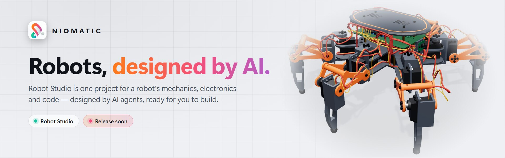
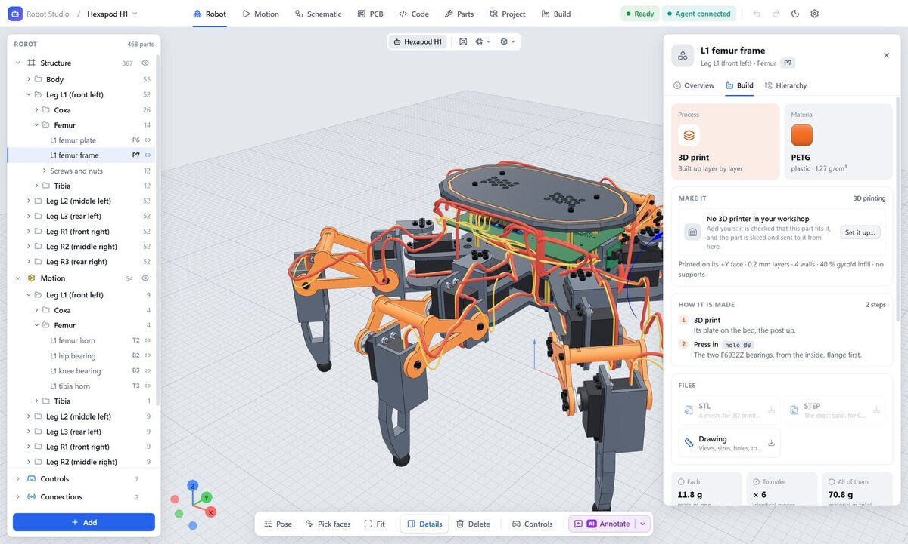
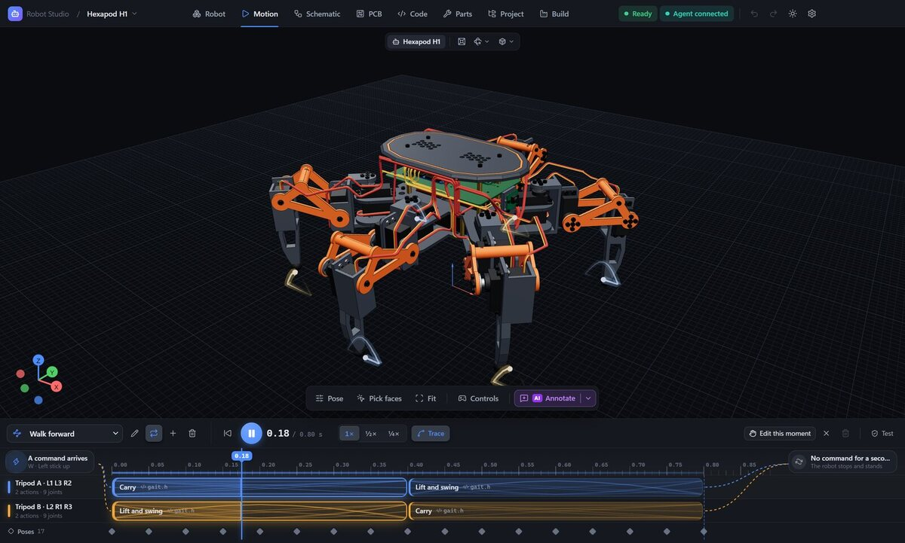
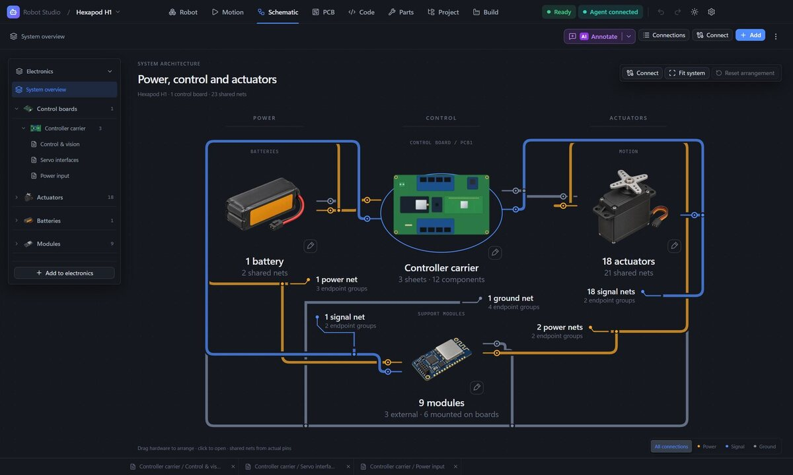
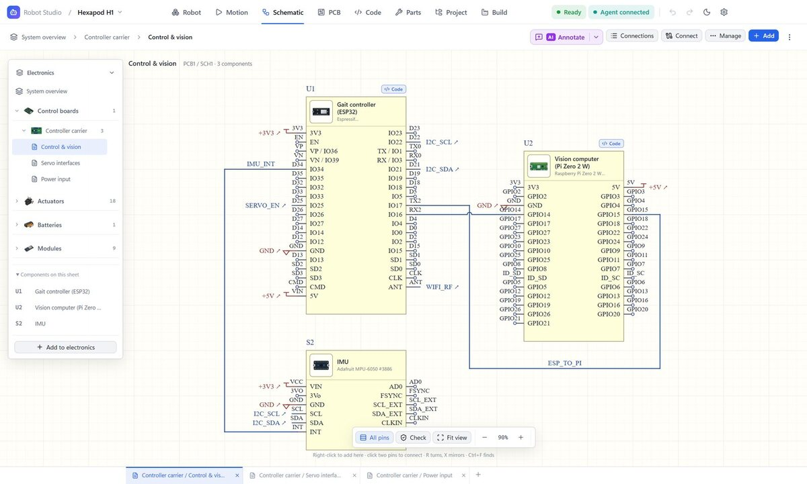
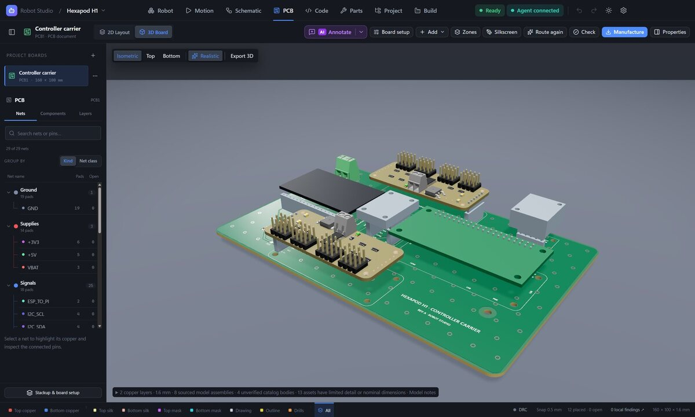
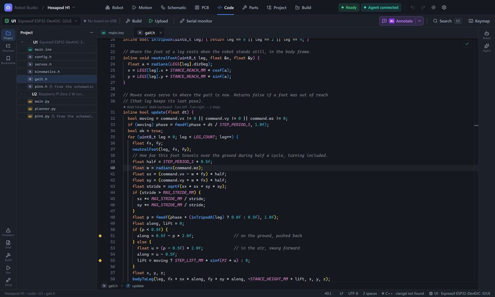
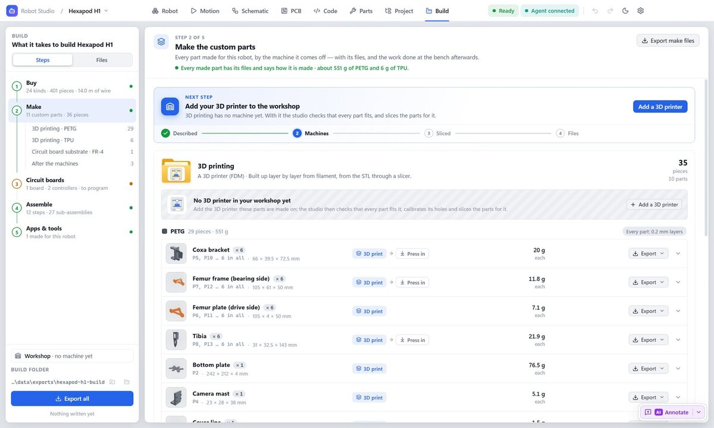
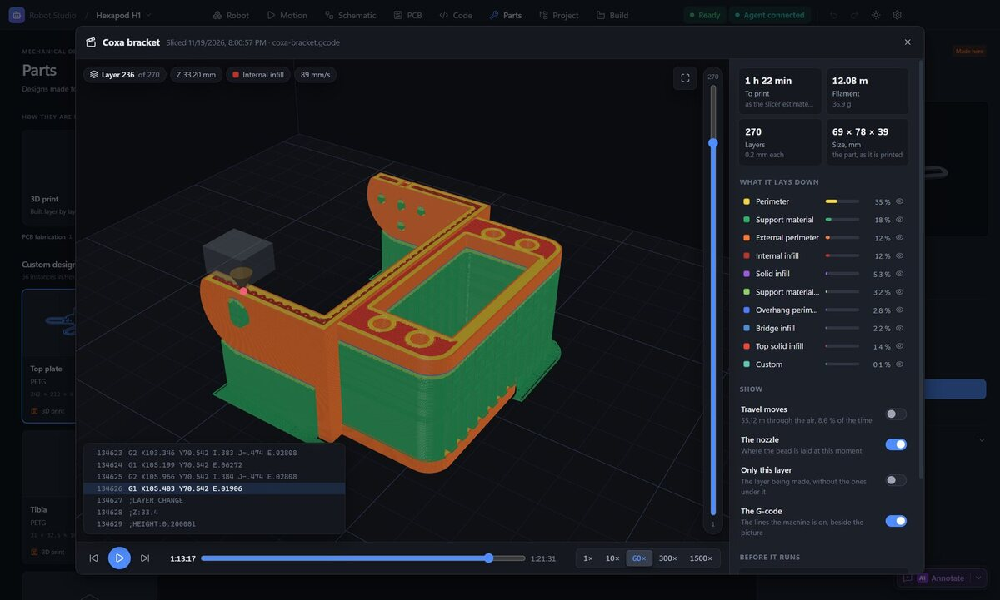

<picture>
  <source media="(prefers-color-scheme: dark)" srcset="assets/banner-dark.jpg">
  
</picture>

 

## Robot Studio

> **Release soon.** Robot Studio is in private development. This page will link to it as soon as it opens.

Robot Studio is a desktop studio in which a robot is **one project**: its 3D assembly and joints, its
schematics and circuit boards, its firmware, and everything it takes to make it. **AI agents do the
design work** through the studio's built-in MCP server — you watch it happen live, look inside every
part, change anything and take over at any time.

<table>
  <tr>
    <td width="50%"> <b>Mechanics</b> — every part says how it is made, and is made from the panel.</td>
    <td width="50%"> <b>Motion</b> — the actions of the firmware on lanes, played on the robot.</td>
  </tr>
  <tr>
    <td width="50%"> <b>System</b> — boards and devices with the connections between them.</td>
    <td width="50%"> <b>Schematic</b> — several boards, each with its pages.</td>
  </tr>
  <tr>
    <td width="50%"> <b>PCB</b> — routed and checked by KiCad's own engines.</td>
    <td width="50%"> <b>Code</b> — a full IDE for the robot's firmware.</td>
  </tr>
  <tr>
    <td width="50%"> <b>Build</b> — what to buy, what to make and in which order.</td>
    <td width="50%"> <b>Make</b> — sliced for your printer and simulated before it is sent.</td>
  </tr>
</table>

### What it does

|  |  |
| --- | --- |
| **Mechanics** | Real B-rep solids, sub-assemblies, joints that move only as they really can, interference and joint-travel checks, wires laid by physics, motions run in a physics engine. |
| **Electronics** | Several boards per robot, professional schematics, PCB layout with Push & Shove routing, copper pours and 1–10 copper layers, design-rule checks and fabrication files. |
| **Code** | A JetBrains-style IDE for the robot's firmware: build and upload to the board, run and deploy Python, the robot's pins inside the code. |
| **Making it** | Drawings with materials and ISO tolerances, parts sliced for your 3D printer and simulated before printing, board files for the fab house, what to buy, the assembly steps. |
| **AI agents** | Close to three hundred MCP tools: whatever a person can do in the window, an agent can do too — and it is told at once what its change broke. |

### Built on open source

Robot Studio integrates established open-source engines rather than reinventing them:
Open CASCADE · KiCad · Freerouting · MuJoCo · Monaco · clangd · PrusaSlicer · three.js · the Model Context Protocol.
